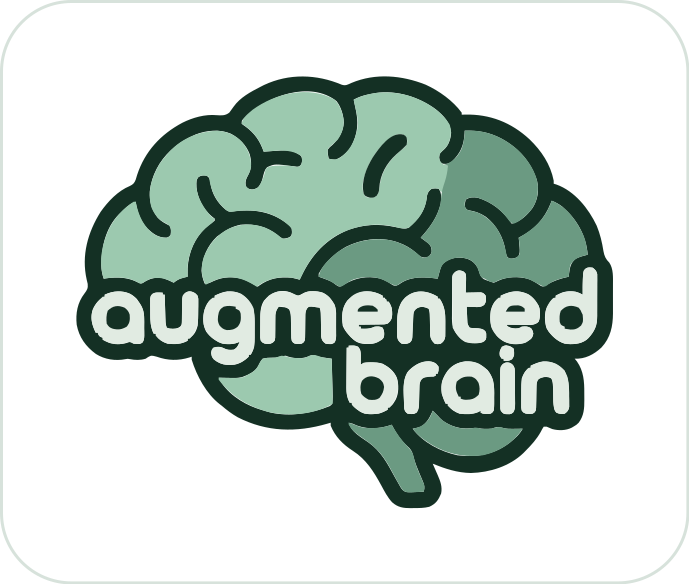

<p align="center">
  
</p>

<p align="center"><b>Tu cerebro, aumentado con IA.</b><br>
Tu asistente recuerda en qué estabais, trabaja con método y te pregunta antes de tocar lo delicado.<br>
Todo queda en ficheros de texto tuyos, con copia en tu propio git.</p>

<p align="center"><a href="https://icalvete.github.io/augmented-brain/es/">Web</a> ·
<a href="https://icalvete.github.io/augmented-brain/guide/index.es.html">Documentación</a> · <a href="README.md">Read in English</a></p>

<p align="center"><a href="https://github.com/icalvete/augmented-brain/actions/workflows/ci.yml?query=branch%3Amain"></a>
<a href="https://github.com/icalvete/augmented-brain/actions/workflows/vuln.yml?query=branch%3Amain"></a>
<a href="https://github.com/icalvete/augmented-brain/releases"></a>
<a href="go.mod"></a>
<a href="LICENSE"></a></p>

<p align="center"><a href="https://github.com/sponsors/icalvete"></a></p>

> [!WARNING]
> **Beta.** Es una versión todavía en pruebas: puede tener errores. Probado por una persona en
> Ubuntu, macOS y Windows 11. Lo que tienes sigue funcionando: cada versión que cambia el
> formato trae el paso que pone al día tus notas. Lee el [aviso legal](DISCLAIMER.md#aviso-legal)
> y las [limitaciones conocidas](https://icalvete.github.io/augmented-brain/guide/limitations.es.html)
> antes de usarlo, y haz copia de lo importante.

---

Los asistentes de IA para programar funcionan muy bien dentro de una sesión y lo
olvidan todo al cerrarla. Vuelves a explicar el mismo contexto, el trabajo a medias se
pierde y nada impide un comando arriesgado en la máquina equivocada.

**augmented brain le da a tu asistente memoria y una forma de trabajar**, guardadas en
ficheros Markdown normales que son tuyos, y lo vigila mientras trabaja.

## Qué hace en el día a día

Le hablas como siempre. Esto es lo que cambia:

| Tú | Qué pasa |
|---|---|
| "¿En qué estábamos?" | Te lista tus tareas vivas, cada una con su siguiente paso y quién la bloquea |
| "Apárcala, mañana seguimos." | Apunta dónde lo dejáis y qué viene después; mañana, en otra sesión, arranca ahí |
| "Recuérdame el jueves que llame al seguro." | Desde una semana antes, te sale cada vez que abres Claude |
| "¿Por qué elegimos el hosting más barato?" | Lo busca en tus notas y te da la decisión, con fecha y porqué |
| "Borra el bucket viejo de producción." | Si marcaste ese perfil de AWS como producción, te pregunta antes de ejecutarlo |
| Abres Claude en `~/augmented-brain/personal` | Solo ve tus notas personales; las del trabajo, no |
| Se te rompe el portátil | `augmented-brain restore` en el nuevo y lo tienes todo |

Más frases: [Qué decirle a Claude](https://icalvete.github.io/augmented-brain/guide/phrases.es.html).

## Empieza en dos pasos

Necesitas:

- **Linux, macOS (13 o posterior) o Windows (10 u 11).**
- **Una cuenta de Claude de pago** (Pro o superior): Claude Code no entra en el plan gratuito.
- **La contraseña de tu ordenador, solo si falta algo.** augmented brain se instala en tu
  propia carpeta, sin root ni administrador. Si falta git (un Ubuntu recién instalado no lo
  trae), el instalador te ofrece instalarlo, y eso pide tu contraseña, o en Windows permiso;
  también la app de escritorio en Linux. Si no tienes esos permisos, pide antes a quien
  cuide tu ordenador que te instale git.

Para instalar no hace falta cuenta de GitHub. La copia de seguridad sí la usa, u otro
servidor de git: la preparas después. ¿Nunca has abierto una terminal? Sigue los
[primeros pasos](https://icalvete.github.io/augmented-brain/guide/getting-started.es.html).

**1. Instálalo** con un solo comando. En Linux o en Mac, en la terminal:

```bash
curl -fsSL https://github.com/icalvete/augmented-brain/releases/latest/download/install.sh | sh
```

En Windows, en PowerShell:

```powershell
irm https://github.com/icalvete/augmented-brain/releases/latest/download/install.ps1 | iex
```

Te pregunta el idioma, te ofrece instalar lo que falte (git, Claude Code, la app de
escritorio de Claude), crea dos espacios, `trabajo` y `personal`, en `~/augmented-brain`
(en inglés, `work` y `personal`), e instala el plugin de Claude Code. Cuando acabe, **abre
una terminal nueva**: la que usaste todavía no ve el comando nuevo. Allí,
`augmented-brain doctor` comprueba que todo está en su sitio. Lo que hace en cada sistema:
[Instalación](https://icalvete.github.io/augmented-brain/guide/install.es.html).

**2. Abre Claude y salúdalo.** Abre la app de Claude, entra con tu cuenta, abre la pestaña
**Code**, pulsa **+ New** y escribe cualquier cosa, con «hola» basta. Sin elegir carpeta
estás en tu espacio personal; para el trabajo, elige con **Choose…** la carpeta
`~/augmented-brain/trabajo`. ¿Sin app? En una terminal, `cd ~/augmented-brain/trabajo &&
claude` (en el PowerShell de Windows, `cd ~\augmented-brain\trabajo; claude`), o la carpeta
`personal` para el otro espacio.

Si Claude te pregunta si confías en la carpeta, di que sí: hasta entonces no puede cargar
tus notas. La primera vez, Claude te contesta con seis preguntas rápidas, explicándote
para qué sirve cada una: quién eres, qué cuidas, cómo quieres las respuestas, qué no se
toca, qué herramientas usas y con quién trabajas. Al final te ofrece preparar la copia de
seguridad.

Las próximas veces, igual. Si algo no va, `augmented-brain doctor` te dice qué falta y
cómo arreglarlo.

## Cómo se ve

> **Tú:** Nueva tarea: añadir un formulario de contacto a la web.
>
> **Claude:** Abierta *task-formulario-de-contacto*, en definición. ¿Qué campos debe tener?
>
> *…acordáis nombre, email y mensaje, y lo dejáis por hoy…*
>
> **Tú:** Apárcala, mañana seguimos con el plan.
>
> **Claude:** Aparcada. Siguiente: escribir el plan.

Al día siguiente, en una **sesión nueva**:

> **Tú:** Seguimos con el formulario de contacto.
>
> **Claude:** Está aparcada con la definición acordada: nombre, email y mensaje, enviado
> por correo. Lo siguiente es el plan. La carpeta del proyecto sigue vacía: ¿dónde está
> el código de la web?

Sin repetir contexto. El asistente leyó la tarea y comprobó el estado real antes de
fiarse de ella.

## Qué te da

- **Tareas con ciclo de vida**: definir, analizar, planificar, ejecutar con diario,
  validar y cerrar. Aparca una tarea y retómala días después. Mira
  [Tareas](https://icalvete.github.io/augmented-brain/guide/tasks.es.html).
- **Trabajo y personal por separado**: cada espacio tiene sus notas, sus reglas y su
  copia. La carpeta en la que abres Claude elige el espacio. Mira
  [Espacios](https://icalvete.github.io/augmented-brain/guide/spaces.es.html).
- **Un guardia** que para los secretos y el hacerse root, para los commits y los push salvo
  en los repositorios que permitas, y te pregunta antes de tocar producción o las máquinas
  que marques como intocables. Es una red contra despistes, no un muro de seguridad. Mira
  [El guardia](https://icalvete.github.io/augmented-brain/guide/guard.es.html).
- **Un panel** en tu navegador: el día de un vistazo, y cada tarea, recordatorio, nota,
  repositorio y nombre de secreto para ver y cambiar. Mira [El panel](https://icalvete.github.io/augmented-brain/guide/panel.es.html).
- **Copia de seguridad y restauración** en un repositorio git privado tuyo, uno por
  espacio, después de cada sesión. Mira
  [Copia de seguridad y restauración](https://icalvete.github.io/augmented-brain/guide/backup.es.html).
- **Ficheros Markdown normales** que son tuyos. Ábrelos con cualquier editor. Mira el
  [formato de la memoria](https://icalvete.github.io/augmented-brain/guide/memory-format.html) (en inglés).

## Comandos

En el día a día le hablas a Claude. Estos son para preparar y revisar:

| Comando | Qué hace |
|---|---|
| `augmented-brain init` | Lo prepara todo: los espacios y el plugin (lo lanza el instalador) |
| `augmented-brain space` | Dice de qué espacio es esta carpeta |
| `augmented-brain space add` | Añade otro espacio |
| `augmented-brain check` | Revisa las notas de este espacio y rehace su índice |
| `augmented-brain doctor` | Dice qué falta y cómo arreglarlo |
| `augmented-brain import <carpeta>` | Trae una memoria que Claude Code ya escribió |
| `augmented-brain backup` | Copia este espacio ahora (`backup setup <url>` lo conecta) |
| `augmented-brain restore <url>` | Recupera un espacio en una máquina nueva |
| `augmented-brain panel` | Abre el panel en el navegador (`panel remote` también desde el móvil, `panel stop` lo para) |
| `augmented-brain remote install` | Deja Claude al alcance del móvil o de otro ordenador |
| `augmented-brain session start <tarea>` | Abre una sesión propia para una tarea (Linux) |
| `augmented-brain config history` | Lista las últimas versiones de tu configuración (`config restore <n>` vuelve a una) |
| `augmented-brain clean` | Limpia lo que deja Claude Code (worktrees viejos y similares) |
| `augmented-brain update` | Actualiza el programa y el plugin |
| `augmented-brain uninstall` | Quita el programa y el plugin; tus notas se quedan |
| `augmented-brain version` | Muestra la versión (`help` lista los comandos) |

Todos los comandos y opciones, y los dos que arranca Claude solo (`mcp` y `hook`):
[Comandos](https://icalvete.github.io/augmented-brain/guide/commands.es.html). Las herramientas que usa Claude:
[Herramientas MCP](https://icalvete.github.io/augmented-brain/guide/mcp-tools.es.html).

## Documentación

Está toda en **[icalvete.github.io/augmented-brain/guide](https://icalvete.github.io/augmented-brain/guide/index.es.html)**, en español
y en inglés:

- **Empezar**: [Primeros pasos](https://icalvete.github.io/augmented-brain/guide/getting-started.es.html),
  [Instalación](https://icalvete.github.io/augmented-brain/guide/install.es.html),
  [Trae una memoria que ya tienes](https://icalvete.github.io/augmented-brain/guide/import.es.html).
- **Conceptos**: [Espacios](https://icalvete.github.io/augmented-brain/guide/spaces.es.html), [Tareas](https://icalvete.github.io/augmented-brain/guide/tasks.es.html),
  [Áreas, conocimiento y lo demás](https://icalvete.github.io/augmented-brain/guide/notes.es.html), [Editar las notas a mano](https://icalvete.github.io/augmented-brain/guide/editing-notes.es.html), [El guardia](https://icalvete.github.io/augmented-brain/guide/guard.es.html),
  [Cómo funciona por dentro](https://icalvete.github.io/augmented-brain/guide/how-it-works.es.html),
  [Qué puede hacer Claude sin preguntarte](https://icalvete.github.io/augmented-brain/guide/what-claude-may-do.es.html),
  [Dónde vive cada cosa](https://icalvete.github.io/augmented-brain/guide/where-things-live.es.html).
- **Día a día**: [Qué decirle a Claude](https://icalvete.github.io/augmented-brain/guide/phrases.es.html), [El panel](https://icalvete.github.io/augmented-brain/guide/panel.es.html),
  [La revisión semanal](https://icalvete.github.io/augmented-brain/guide/weekly-review.es.html).
- **Ponlo a tu medida**: [Conecta tus servicios](https://icalvete.github.io/augmented-brain/guide/connect-services.es.html),
  [Copia de seguridad y restauración](https://icalvete.github.io/augmented-brain/guide/backup.es.html),
  [Versiones de la configuración](https://icalvete.github.io/augmented-brain/guide/config-history.es.html),
  [Desde el móvil u otro ordenador](https://icalvete.github.io/augmented-brain/guide/anywhere.es.html),
  [Acceso remoto](https://icalvete.github.io/augmented-brain/guide/remote.es.html),
  [Una sesión por tarea](https://icalvete.github.io/augmented-brain/guide/task-sessions.es.html),
  [El panel desde otro dispositivo](https://icalvete.github.io/augmented-brain/guide/panel-remote.es.html),
  [Actualizar y desinstalar](https://icalvete.github.io/augmented-brain/guide/update-and-uninstall.es.html).
- **Referencia**: [Comandos](https://icalvete.github.io/augmented-brain/guide/commands.es.html), [Herramientas MCP](https://icalvete.github.io/augmented-brain/guide/mcp-tools.es.html),
  [Configuración](https://icalvete.github.io/augmented-brain/guide/configuration.es.html),
  [Formato de la memoria](https://icalvete.github.io/augmented-brain/guide/memory-format.html) (en inglés),
  [Lo que no cambia](https://icalvete.github.io/augmented-brain/guide/compatibility.es.html).
- **Ayuda**: [Si algo falla](https://icalvete.github.io/augmented-brain/guide/troubleshooting.es.html), [Limitaciones conocidas](https://icalvete.github.io/augmented-brain/guide/limitations.es.html),
  [Registro de cambios](CHANGELOG.es.md).

Inspirado en *Building a Second Brain* de Tiago Forte y *Getting Things Done* de David
Allen, adaptados a trabajar con un asistente de IA.

## Desarrollo

Necesita Go 1.26 o posterior. `go test ./...` y `go build ./cmd/augmented-brain`. ¿Trabajas
con un agente de IA? Su manual es [AGENTS.md](AGENTS.md) (en inglés): el mapa del código,
las comprobaciones y las reglas de la casa.

## Apoya el proyecto

augmented brain es libre y gratis (licencia MIT). Si te ahorra tiempo, puedes
[patrocinar su desarrollo](https://github.com/sponsors/icalvete): paga el tiempo de responder incidencias y añadir funciones. También hay [soporte de pago](https://github.com/sponsors/icalvete):
respuesta por correo en dos días laborables, o una sesión de puesta en marcha de una hora por videollamada.

## Licencia

MIT. Ver [LICENSE](LICENSE) y el [aviso legal](DISCLAIMER.md#aviso-legal). Sin
relación con Anthropic; "Claude" y "Claude Code" son marcas de Anthropic, PBC.
