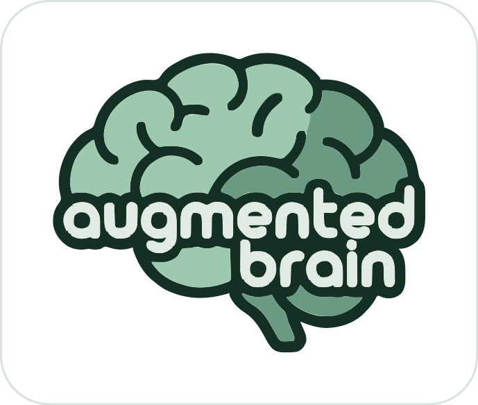

<p align="center">
  
</p>

<p align="center"><b>Un segundo cerebro para trabajar con asistentes de IA.</b><br>
Tareas, áreas y reglas que tu asistente recuerda de una sesión a otra.</p>

<p align="center"><a href="README.md">Read in English</a></p>

> [!WARNING]
> **Alfa.** Es una versión temprana: puede tener errores, su formato y sus comandos
> pueden cambiar, y solo se ha probado en Linux. Lee el [aviso legal](DISCLAIMER.md#aviso-legal)
> antes de usarlo, y haz copia de lo importante.

---

Los asistentes de IA para programar funcionan muy bien dentro de una sesión y lo
olvidan todo al cerrarla. Vuelves a explicar el mismo contexto, el trabajo a medias se
pierde y nada impide un comando arriesgado en la máquina equivocada.

**augmented brain le da a tu asistente memoria y una forma de trabajar**, guardadas en
ficheros Markdown normales que son tuyos, y lo vigila mientras trabaja.

## Empieza en tres pasos

Linux o macOS, con [Claude Code](https://docs.claude.com/en/docs/claude-code) instalado.

```bash
curl -fsSL https://github.com/icalvete/augmented-brain/releases/latest/download/install.sh | sh
augmented-brain init
augmented-brain doctor
```

`init` te pregunta el idioma, un nombre para tu primer espacio y la carpeta en la que
trabajas, e instala el plugin de Claude Code. `doctor` te dice si falta algo y cómo
arreglarlo. Después, abre Claude Code en tu carpeta de trabajo.

Si justo después de instalar no se encuentra `augmented-brain`, abre una terminal nueva; si su
carpeta no está en tu `PATH`, el instalador te dice qué línea añadir a tu perfil de la terminal.

## Cómo se ve

> **Tú:** Nueva tarea: añadir un formulario de contacto a la web.
>
> **Claude:** Abierta *task-formulario-de-contacto*, en definición. ¿Qué campos debe tener?
>
> *…acordáis nombre, email y mensaje, y lo dejáis por hoy…*
>
> **Tú:** Apárcala, mañana seguimos con el plan.
>
> **Claude:** Aparcada. Siguiente: escribir el plan.

Al día siguiente, en una **sesión nueva**:

> **Tú:** Seguimos con el formulario de contacto.
>
> **Claude:** Está aparcada con la definición acordada: nombre, email y mensaje, enviado
> por correo. Lo siguiente es el plan. La carpeta del proyecto sigue vacía: ¿dónde está
> el código de la web?

Sin repetir contexto. El asistente leyó la tarea y comprobó el estado real antes de
fiarse de ella.

## Qué te da

- **Tareas con ciclo de vida**: definir, analizar, planificar, ejecutar con diario,
  validar y cerrar. Aparcas una tarea y la retomas días después, en cualquier sesión.
- **Áreas** que agrupan las tareas y el conocimiento de cada responsabilidad.
- **Reglas cargadas en cada sesión**, y las importantes vigiladas por un guardia: nada
  de commit ni push salvo que lo permitas, nunca root, ningún secreto en comandos ni
  ficheros. Los perfiles de AWS de producción y los hosts que marques como intocables
  te piden confirmación, también por `ssh`.
- **Trabajo y personal, separados**: cada *espacio* tiene su memoria, sus reglas y su
  copia de seguridad. La carpeta en la que abres el asistente elige el espacio.
- **Copia de seguridad y restauración** en un repositorio git privado tuyo, uno por
  espacio.
- **Tus servicios** (calendario, correo, Jira…) por MCP: mira
  [Conecta tus servicios](docs/guide/connect-services.es.md).

## Comandos

| Comando | Qué hace |
|---|---|
| `augmented-brain init` | Monta augmented brain y tu primer espacio |
| `augmented-brain space add` | Añade otro espacio (personal, un cliente…) |
| `augmented-brain doctor` | Dice qué falta y cómo arreglarlo |
| `augmented-brain check` | Revisa las notas del espacio de esta carpeta y rehace su índice |
| `augmented-brain backup setup <url>` | Conecta este espacio a un repositorio git privado |
| `augmented-brain backup` | Guarda los últimos cambios (`--all` para todos los espacios) |
| `augmented-brain restore <url>` | Recupera un espacio en una máquina nueva |

El trabajo de cada día ocurre dentro de Claude Code, con tus palabras: "nueva tarea…",
"¿qué tengo pendiente?", "apárcala", "apunta esto en el buzón".

## Cómo funciona

- **Tu memoria es Markdown**, una carpeta por espacio: `tasks/`, `areas/`,
  `knowledge/`, `rules/`. Ábrela y edítala con cualquier editor. El formato está en
  [docs/spec/memory-format.md](docs/spec/memory-format.md) (en inglés).
- **Un solo programa**, `augmented-brain`, escrito en Go. Nada más que instalar.
- **Un servidor MCP** da a tu asistente las herramientas del método, así que otros
  asistentes también pueden usarlo. Claude Code es el primero.
- **Un plugin de Claude Code** carga tu espacio al empezar cada sesión y pasa el guardia
  antes de cada comando y cada escritura de fichero. El guardia es una red contra
  errores, no una barrera de seguridad.

Las cuatro capas, una sesión paso a paso y dónde vive cada fichero:
[Cómo funciona](docs/guide/how-it-works.es.md).

Inspirado en *Building a Second Brain*, de Tiago Forte, y *Getting Things Done*, de
David Allen, adaptados a trabajar con un asistente de IA.

## Desarrollo

Necesita Go 1.25 o posterior (un `go` más antiguo lo descarga solo).

```bash
go test ./...
go build ./cmd/augmented-brain
```

`scripts/e2e-claude.sh` prueba la historia entera (abrir, aparcar, retomar y cerrar una
tarea, y el guardia) con un Claude Code de verdad y aislado. Gasta uso: lánzalo antes de
cada versión.

La marca (logo, iconos y paleta) está en [`assets/brand/`](assets/brand/), y se ve en su
sitio en [`docs/brand.html`](docs/brand.html).
[`scripts/privacy-check.sh`](scripts/privacy-check.sh) bloquea los commits que
publicarían datos personales o secretos.

## Licencia

MIT. Ver [LICENSE](LICENSE) y el [aviso legal](DISCLAIMER.md#aviso-legal). Sin
relación con Anthropic; "Claude" y "Claude Code" son marcas de Anthropic, PBC.
