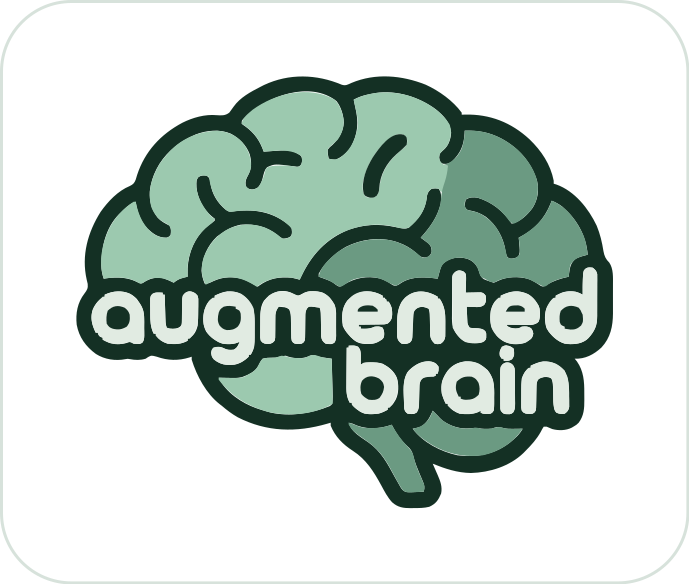

<p align="center">
  
</p>

<p align="center"><b>Your brain, augmented with AI.</b><br>
Your assistant remembers where you left off, works with a method, and asks before touching anything risky.<br>
All in plain text files of yours, backed up to your own git.</p>

<p align="center"><a href="https://icalvete.github.io/augmented-brain/">Website</a> ·
<a href="https://icalvete.github.io/augmented-brain/guide/">Documentation</a> · <a href="README.es.md">Leer en español</a></p>

<p align="center"><a href="https://github.com/icalvete/augmented-brain/actions/workflows/ci.yml?query=branch%3Amain"></a>
<a href="https://github.com/icalvete/augmented-brain/actions/workflows/vuln.yml?query=branch%3Amain"></a>
<a href="https://github.com/icalvete/augmented-brain/releases"></a>
<a href="go.mod"></a>
<a href="LICENSE"></a></p>

<p align="center"><a href="https://github.com/sponsors/icalvete"></a></p>

> [!WARNING]
> **Beta.** This version is still being tested: it may have bugs. Tested by a person on Ubuntu,
> macOS and Windows 11. What you have keeps working: each version that changes the
> format brings the step that moves your notes forward. Read the [disclaimer](DISCLAIMER.md)
> and the [known limitations](https://icalvete.github.io/augmented-brain/guide/limitations.html)
> before you use it, and back up anything important.

---

AI coding assistants are great inside one session and forget everything when it ends.
You explain the same context again, half-finished work gets lost, and nothing stops a
risky command on the wrong machine.

**augmented brain gives your assistant a memory and a way of working**, kept as plain
Markdown files that you own, and guards it while it works.

## What it does, day to day

You talk to it as usual. This is what changes:

| You | What happens |
|---|---|
| "Where were we?" | It lists your live tasks, each with its next step and who holds it up |
| "Park it, we carry on tomorrow." | It writes down where you stopped and what comes next; tomorrow, in a new session, it starts there |
| "Remind me on Thursday to call the insurance." | From a week before, it comes up every time you open Claude |
| "Why did we pick the cheaper host?" | It looks it up in your notes and gives you the decision, with date and reason |
| "Delete the old bucket in production." | If you marked that AWS profile as production, it asks you before running it |
| You open Claude in `~/augmented-brain/personal` | It only sees your personal notes; not the work ones |
| Your laptop dies | `augmented-brain restore` on the new one and it is all back |

More phrases: [What to say to Claude](https://icalvete.github.io/augmented-brain/guide/phrases.html).

## Start in two steps

You need:

- **Linux, macOS (13 or later) or Windows (10 or 11).**
- **A paid Claude account** (Pro or above): Claude Code is not in the free plan.
- **Your computer's password, only if something is missing.** augmented brain installs in
  your own folder, without root or administrator. If git is missing (a fresh Ubuntu has
  none), the installer offers to install it, and that asks for your password, or on Windows
  for permission; so does the desktop app on Linux. Without those rights, ask whoever looks
  after your computer to install git first.

Installing needs no GitHub account. The backup does, or another git server: you set it up
later. Never opened a terminal? Follow [Getting started](https://icalvete.github.io/augmented-brain/guide/getting-started.html).

**1. Install it** with one command. On Linux or a Mac, in the terminal:

```bash
curl -fsSL https://github.com/icalvete/augmented-brain/releases/latest/download/install.sh | sh
```

On Windows, in PowerShell:

```powershell
irm https://github.com/icalvete/augmented-brain/releases/latest/download/install.ps1 | iex
```

It asks the language, offers to install what is missing (git, Claude Code, the Claude
desktop app), creates two spaces, `work` and `personal`, in `~/augmented-brain` (in
Spanish, `trabajo` and `personal`), and installs the Claude Code plugin. When it ends,
**open a new terminal**: the one you used does not see the new command yet. There,
`augmented-brain doctor` checks that everything is in place. What it does on each system:
[Installing](https://icalvete.github.io/augmented-brain/guide/install.html).

**2. Open Claude and say hello.** Open the Claude app, sign in, open the **Code** tab,
click **+ New** and write anything, "hello" will do. Without choosing a folder you are in
your personal space; for work, pick the folder `~/augmented-brain/work` with **Choose…**.
No app? In a terminal, `cd ~/augmented-brain/work && claude` (in Windows PowerShell,
`cd ~\augmented-brain\work; claude`), or the `personal` folder for the other space.

If Claude asks whether you trust the folder, say yes: until then it cannot load your
notes. The first time, Claude answers with six quick questions, saying what each one is
for: who you are, what you look after, how you want answers, what must not be touched,
which tools you use and who you work with. At the end it offers to set up the backup.

From then on, the same. If something is off, `augmented-brain doctor` tells you what is
missing and how to fix it.

## What it looks like

> **You:** New task: add a contact form to the website.
>
> **Claude:** Opened *task-contact-form*, in definition. What fields should it have?
>
> *…you agree on name, email and message, and stop for the day…*
>
> **You:** Park it, we continue tomorrow with the plan.
>
> **Claude:** Parked. Next: write the plan.

The next day, in a **new session**:

> **You:** Let's continue with the contact form.
>
> **Claude:** It is parked with the definition agreed: name, email and message, sent by
> email. Next is the plan. The project folder is still empty: where is the website code?

No context to repeat. The assistant read the task and checked the real state before
trusting it.

## What you get

- **Tasks with a life cycle**: define, analyse, plan, execute with a journal, validate,
  close. Park a task and resume it days later. See [Tasks](https://icalvete.github.io/augmented-brain/guide/tasks.html).
- **Work and personal apart**: each space has its own notes, rules and backup. The folder
  you open Claude in picks the space. See [Spaces](https://icalvete.github.io/augmented-brain/guide/spaces.html).
- **A guard** that stops secrets and becoming root, stops commits and pushes except in the
  repositories you allow, and asks before production and the machines you mark as
  untouchable. It is a safety net against
  mistakes, not a security boundary. See [The guard](https://icalvete.github.io/augmented-brain/guide/guard.html).
- **A panel** in your browser: today at a glance, and every task, reminder, note,
  repository and secret name to see and edit. See [The panel](https://icalvete.github.io/augmented-brain/guide/panel.html).
- **Backup and restore** to a private git repository of yours, one per space, after every
  session. See [Backup and restore](https://icalvete.github.io/augmented-brain/guide/backup.html).
- **Plain Markdown files** that are yours. Open them with any editor. See the
  [memory format](https://icalvete.github.io/augmented-brain/guide/memory-format.html).

## Commands

Day to day you talk to Claude. These are for setting up and checking:

| Command | What it does |
|---|---|
| `augmented-brain init` | Set everything up: the spaces and the plugin (the installer runs it) |
| `augmented-brain space` | Say which space this folder belongs to |
| `augmented-brain space add` | Add another space |
| `augmented-brain check` | Check this space's notes and rebuild its index |
| `augmented-brain doctor` | Say what is missing, and how to fix it |
| `augmented-brain import <folder>` | Bring in a memory Claude Code already wrote |
| `augmented-brain backup` | Back up this space now (`backup setup <url>` connects it) |
| `augmented-brain restore <url>` | Bring a space back on a new machine |
| `augmented-brain panel` | Open the panel in your browser (`panel remote` also from your phone, `panel stop` stops it) |
| `augmented-brain remote install` | Keep Claude reachable from your phone or another computer |
| `augmented-brain session start <task>` | Open a session of its own for a task (Linux) |
| `augmented-brain config history` | List the last versions of your configuration (`config restore <n>` goes back to one) |
| `augmented-brain clean` | Clean up what Claude Code left behind (old worktrees and the like) |
| `augmented-brain update` | Update the program and the plugin |
| `augmented-brain uninstall` | Remove the program and the plugin; your notes stay |
| `augmented-brain version` | Print the version (`help` lists the commands) |

Every command and option, and the two Claude starts by itself (`mcp` and `hook`):
[Commands](https://icalvete.github.io/augmented-brain/guide/commands.html). The tools Claude uses:
[MCP tools](https://icalvete.github.io/augmented-brain/guide/mcp-tools.html).

## Documentation

All of it is at **[icalvete.github.io/augmented-brain/guide](https://icalvete.github.io/augmented-brain/guide/)**, in English and
Spanish:

- **Get started**: [Getting started](https://icalvete.github.io/augmented-brain/guide/getting-started.html), [Installing](https://icalvete.github.io/augmented-brain/guide/install.html),
  [Bring in a memory](https://icalvete.github.io/augmented-brain/guide/import.html).
- **Concepts**: [Spaces](https://icalvete.github.io/augmented-brain/guide/spaces.html), [Tasks](https://icalvete.github.io/augmented-brain/guide/tasks.html),
  [Areas, knowledge and the rest](https://icalvete.github.io/augmented-brain/guide/notes.html), [Editing notes by hand](https://icalvete.github.io/augmented-brain/guide/editing-notes.html), [The guard](https://icalvete.github.io/augmented-brain/guide/guard.html),
  [How it works inside](https://icalvete.github.io/augmented-brain/guide/how-it-works.html), [What Claude may do without asking you](https://icalvete.github.io/augmented-brain/guide/what-claude-may-do.html),
  [Where everything lives](https://icalvete.github.io/augmented-brain/guide/where-things-live.html).
- **Daily use**: [What to say to Claude](https://icalvete.github.io/augmented-brain/guide/phrases.html), [The panel](https://icalvete.github.io/augmented-brain/guide/panel.html),
  [The weekly review](https://icalvete.github.io/augmented-brain/guide/weekly-review.html).
- **Make it yours**: [Connect your services](https://icalvete.github.io/augmented-brain/guide/connect-services.html), [Backup and restore](https://icalvete.github.io/augmented-brain/guide/backup.html),
  [Configuration versions](https://icalvete.github.io/augmented-brain/guide/config-history.html), [From your phone or another computer](https://icalvete.github.io/augmented-brain/guide/anywhere.html),
  [Remote access](https://icalvete.github.io/augmented-brain/guide/remote.html), [A session per task](https://icalvete.github.io/augmented-brain/guide/task-sessions.html),
  [The panel from another device](https://icalvete.github.io/augmented-brain/guide/panel-remote.html),
  [Updating and uninstalling](https://icalvete.github.io/augmented-brain/guide/update-and-uninstall.html).
- **Reference**: [Commands](https://icalvete.github.io/augmented-brain/guide/commands.html), [MCP tools](https://icalvete.github.io/augmented-brain/guide/mcp-tools.html),
  [Configuration](https://icalvete.github.io/augmented-brain/guide/configuration.html), [Memory format](https://icalvete.github.io/augmented-brain/guide/memory-format.html),
  [What stays stable](https://icalvete.github.io/augmented-brain/guide/compatibility.html).
- **Help**: [Troubleshooting](https://icalvete.github.io/augmented-brain/guide/troubleshooting.html), [Known limitations](https://icalvete.github.io/augmented-brain/guide/limitations.html), [Changelog](CHANGELOG.md).

Inspired by *Building a Second Brain* by Tiago Forte and *Getting Things Done* by David
Allen, adapted to working with an AI assistant.

## Development

Needs Go 1.26 or later. `go test ./...` and `go build ./cmd/augmented-brain`. Working
with an AI coding agent? Its handbook is [AGENTS.md](AGENTS.md): the map of the code, the
checks and the rules of the house.

## Support the project

augmented brain is free and MIT-licensed. If it saves you time, you can
[sponsor its development](https://github.com/sponsors/icalvete): it pays for the time to answer issues and add features. [Paid support](https://github.com/sponsors/icalvete) is there too:
answers by email within two working days, or a one-hour setup session by video call.

## License

MIT. See [LICENSE](LICENSE) and the [disclaimer](DISCLAIMER.md). Not affiliated with
Anthropic; "Claude" and "Claude Code" are trademarks of Anthropic, PBC.
