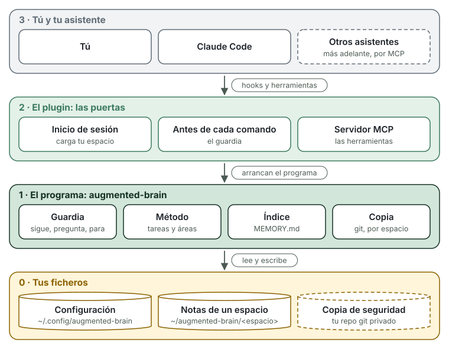
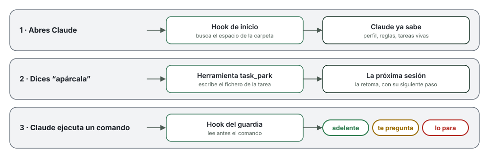

# Cómo funciona

[Read in English](how-it-works.md)

augmented brain es un programa pequeño y una carpeta de notas. Así encajan las piezas:

<picture>
  <source media="(max-width: 600px)" srcset="../img/how-layers-narrow.es.svg">
  
</picture>

## Cuatro capas

| Capa | Qué es | Dónde vive |
|---|---|---|
| **3 · Tú y tu asistente** | Hablas con Claude Code como siempre. No hay comandos nuevos que aprender. | Tu terminal |
| **2 · El plugin** | Las puertas por las que Claude entra al programa: dos hooks y un servidor MCP. | Dentro de Claude Code, que lo instala |
| **1 · El programa** | `augmented-brain`, un solo fichero. Vigila los comandos, lleva las tareas, rehace el índice y hace la copia. | `~/.local/bin/augmented-brain` |
| **0 · Tus ficheros** | Texto normal: la configuración, tus notas y, si quieres, su copia. | `~/.config/augmented-brain/`, `~/augmented-brain/` y tu repo git |

Dicho de otra forma: **tus notas son un cuaderno, el programa es quien lo ordena y el
plugin es la puerta.** Tú solo hablas con Claude; Claude entra por la puerta y el programa
escribe en el cuaderno.

Dos palabras que salen mucho:

- **Hook**: un aviso que Claude Code lanza en un momento concreto. Aquí, al empezar la
  sesión y antes de cada comando. En cada aviso, Claude Code arranca el programa, le
  pregunta y el programa termina. No queda nada funcionando de fondo.
- **MCP** (Model Context Protocol): un estándar abierto para dar herramientas a un
  asistente. El programa ofrece las suyas ("abre una tarea", "apárcala") y Claude las usa.
  Al ser un estándar, otros asistentes podrán usar las mismas.

## Una sesión, paso a paso

<picture>
  <source media="(max-width: 600px)" srcset="../img/how-session-narrow.es.svg">
  
</picture>

**1. Abres Claude.** El hook de inicio mira en qué carpeta estás y elige tu espacio. Antes
de que escribas nada, le pasa a Claude tu perfil, tus reglas y la lista de tareas vivas.
Por eso sabe dónde lo dejaste.

**2. Dices "apárcala".** Claude usa la herramienta `task_park`. El programa apunta en el
fichero de la tarea dónde se quedó y cuál es el siguiente paso, y rehace el índice. La
próxima sesión empieza desde ahí. Abrir, retomar y cerrar funcionan igual.

**3. Claude va a ejecutar un comando.** El hook del guardia lo lee antes y decide:

- **Adelante**: casi siempre. `ls`, `go test`, `aws --profile dev s3 ls`.
- **Te pregunta**: producción, o una máquina que marcaste como intocable.
  `aws --profile prod …`, `ssh db01 …`.
- **Lo para**: subir código, root y secretos. `git push`, `sudo …`, un token en un comando.

También mira dentro de `ssh`, de `bash -c` y de los bucles. Es una red contra despistes,
no un muro de seguridad: lee el [aviso legal](../../DISCLAIMER.md#aviso-legal).

## Tus ficheros

Cada **espacio** tiene su carpeta de notas:

```
~/augmented-brain/trabajo/
├── MEMORY.md     el índice que Claude lee al empezar (lo genera el programa)
├── inbox.md      apuntes rápidos, para ordenar luego
├── areas/        lo que cuidas siempre: "la web", "los servidores"
├── tasks/        un fichero por tarea
├── knowledge/    cómo funcionan las cosas y lo aprendido
├── rules/        reglas solo de este espacio
├── reviews/      revisiones semanales
└── archive/      lo antiguo; no se carga y no se borra
```

Una tarea es un fichero de texto. Arriba, entre las líneas `---`, los datos que usa el
programa. Debajo, lo que escribís tú y Claude:

```markdown
---
id: task-anadir-un-formulario-de-contacto
type: task
title: Añadir un formulario de contacto
area: area-web
status: parked
waiting_on: me
next: Escribir el plan
created: "2026-10-15"
updated: "2026-10-15"
---
## Lo esencial
Nombre, correo y mensaje, enviado por email.

## Diario
- 2026-10-15 — Tarea abierta.
- 2026-10-15 — Aparcada. Siguiente: Escribir el plan
```

Puedes abrir y editar todo con cualquier editor. El formato completo está en
[memory-format.md](../spec/memory-format.md) (en inglés).

## Trabajo y personal, separados

Un espacio es un juego completo de notas, reglas y copia. **La carpeta donde abres Claude
elige el espacio**, según tu configuración:

```toml
# ~/.config/augmented-brain/config.toml
[spaces.trabajo]
memory = "~/augmented-brain/trabajo"
work_folders = ["~/trabajo"]

[spaces.personal]
memory = "~/augmented-brain/personal"
work_folders = ["~/personal"]
```

En `~/trabajo/web`, Claude ve las notas del trabajo. En `~/personal/blog`, las personales.
Nunca se mezclan. Para añadir otro: `augmented-brain space add`.

## La copia de seguridad

La carpeta de notas de cada espacio es también un repositorio git. La copia lo sube a un
repositorio privado tuyo. Se monta una vez:

```bash
augmented-brain backup setup git@github.com:tu-usuario/mi-cerebro.git
```

Y desde entonces, cuando quieras (al acabar el día, por ejemplo):

```bash
augmented-brain backup          # este espacio
augmented-brain backup --all    # todos
```

Lo que te da:

- **Una máquina nueva en minutos.** `augmented-brain restore <url>` trae el espacio
  entero: notas, tareas, reglas, tu perfil y la configuración del espacio. Abres Claude y
  sigue donde lo dejaste.
- **Varias máquinas, un solo cerebro.** Antes de subir, la copia trae lo que hizo tu otra
  máquina y lo mezcla.
- **Todo el historial.** Cada copia es un commit de git, con la máquina y la hora. Con
  `git log` ves qué cambió y puedes volver a cualquier día.
- **En tu sitio.** GitHub, GitLab o tu servidor: el repositorio lo eliges tú. No hay nube
  de augmented brain.
- **Un repositorio por espacio.** El del trabajo puede ir al git de la empresa y el
  personal al tuyo.
- **No sube secretos.** Si una nota tiene algo que parece una contraseña o un token, la
  copia se para y te dice en qué fichero.
- **No pisa nada.** Si dos máquinas cambiaron la misma nota, se para sin tocar nada y te
  explica cómo resolverlo. El índice, que es generado, se rehace solo.

Todavía no se lanza sola: es un comando tuyo.

## Lo que no hace

- **No hay servidor ni cuenta.** Si Claude no está abierto, no funciona nada.
- **No envía datos a nadie.** Solo la copia, si la configuras, habla con tu repositorio.
- **No toca tus ajustes de Claude Code.** El plugin se pone y se quita con los comandos
  de Claude Code.
- **Ojo: tu asistente lee tus notas**, como cualquier fichero que abre. Viajan con tus
  conversaciones a su proveedor. No guardes ahí lo que no compartirías.

## Quitarlo

```bash
claude plugin uninstall brain@augmented-brain
claude plugin marketplace remove augmented-brain
rm ~/.local/bin/augmented-brain
rm -r ~/.config/augmented-brain        # configuración y perfil
```

Tus notas se quedan en `~/augmented-brain/`. Son tuyas.
