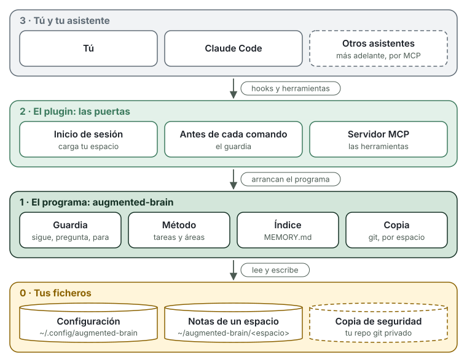
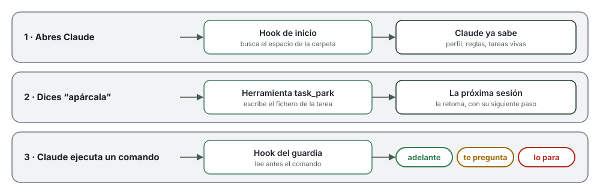

# Cómo funciona por dentro

[Read in English](how-it-works.md)

augmented brain es un programa pequeño y una carpeta de notas. Esta página cuenta cómo
encajan las piezas. Para usarlo, no te hace falta nada de esto.

<picture>
  <source media="(max-width: 600px)" srcset="../img/how-layers-narrow.es.svg">
  
</picture>

## Cuatro capas

| Capa | Qué es | Dónde vive |
|---|---|---|
| **3 · Tú y tu asistente** | Hablas con Claude Code como siempre. No hay comandos nuevos que aprender. | Tu terminal o la app de Claude |
| **2 · El plugin** | Las puertas por las que Claude entra al programa: varios hooks y un servidor MCP. | Dentro de Claude Code, que lo instala |
| **1 · El programa** | `augmented-brain`, un solo fichero. Vigila los comandos, lleva las tareas, rehace el índice y hace la copia de seguridad. | `~/.local/bin/augmented-brain` |
| **0 · Tus ficheros** | Texto normal: la configuración, tus notas y, si quieres, su copia de seguridad. | `~/.config/augmented-brain/`, `~/augmented-brain/` y tu repositorio git |

Dicho de otra forma: **tus notas son un cuaderno, el programa es quien lo ordena y el
plugin es la puerta.** Tú solo hablas con Claude. Claude entra por la puerta y el
programa escribe en el cuaderno.

Dos palabras que salen mucho:

- **Hook**: un aviso que Claude Code lanza en un momento concreto. Aquí, al empezar la
  sesión, antes de que Claude conteste cada mensaje (para decirle qué tareas cambiaron en
  otra sesión), antes de cada comando y cada cambio de fichero, después de cada respuesta,
  cuando una conversación larga se compacta y cuando la sesión termina. En cada aviso,
  Claude Code arranca el programa, le pregunta y el programa termina.
- **MCP** (Model Context Protocol): un estándar abierto para dar herramientas a un
  asistente. El programa ofrece las suyas ("abre una tarea", "apárcala") y Claude las usa.
  Al ser un estándar, otros asistentes podrán usar las mismas.

La lista de hooks está en [Comandos](commands.es.md#augmented-brain-hook). Las
herramientas, en [Herramientas MCP](mcp-tools.es.md).

## Una sesión, paso a paso

<picture>
  <source media="(max-width: 600px)" srcset="../img/how-session-narrow.es.svg">
  
</picture>

**1. Abres Claude.** El hook de inicio mira en qué carpeta estás y elige tu
[espacio](spaces.es.md). Antes de que escribas nada, le pasa a Claude tu perfil, tus
reglas y la lista de tareas vivas. También le dice lo que vence pronto, si toca la
revisión semanal y si una sesión anterior se cortó. Por eso Claude sabe dónde lo dejaste.
Una sesión abierta para una tarea (`session start`) solo oye las fechas de esa tarea.

**2. Dices "apárcala".** Claude usa la herramienta `task_park`. El programa apunta en el
fichero de la tarea dónde se quedó y cuál es el siguiente paso, y rehace el índice. Abrir,
retomar y cerrar funcionan igual. Mira [Tareas](tasks.es.md).

**3. Claude va a ejecutar un comando.** El hook del guardia lo lee antes, y lo deja pasar,
te pregunta o lo para. Mira [El guardia](guard.es.md).

**4. Claude termina una respuesta.** Si la sesión tiene una tarea abierta y en 20 minutos
no se ha escrito nada en ella, un hook le recuerda a Claude que escriba en su diario, una
vez. Cada sesión tiene su propia tarea, así que dos ventanas nunca reciben el aviso de la
otra. El
mismo hook mira la memoria de la ventana: si ha crecido mucho más de lo normal, Claude te
lo dice, para que aparques la tarea antes de que el sistema cierre la ventana. Mira
[Si algo falla](troubleshooting.es.md#la-ventana-usa-mucha-memoria).

**5. Cierras la sesión.** El hook de cierre apunta que la sesión acabó bien. Lanza la
[copia de seguridad](backup.es.md) del espacio por detrás, si la has configurado. No
esperas a nada. Si la red no contesta, la copia se rinde a los 3 minutos en vez de
quedarse colgada. Si la copia falla, Claude te lo dice al empezar la siguiente sesión.

Si una sesión no acabó bien (se cerró la ventana a la fuerza, se apagó el ordenador), la
siguiente te ofrece recuperarla. Claude lee lo que os dijisteis después de la última
entrada del diario de la tarea, en el registro de la conversación que guarda Claude Code
en este ordenador (lo guarda 30 días), y apunta lo que falte.

## Dónde viven los ficheros

Tus notas, una carpeta por espacio:

```
~/augmented-brain/
├── trabajo/              una carpeta de trabajo: abre Claude aquí para lo del trabajo
│   ├── notas/
│   │   ├── MEMORY.md     el índice que Claude lee al empezar (lo escribe el programa)
│   │   ├── inbox.md      apuntes rápidos, para ordenar luego
│   │   ├── areas/        lo que cuidas siempre
│   │   ├── tasks/        un fichero por tarea
│   │   ├── knowledge/    cómo funcionan las cosas y lo aprendido
│   │   ├── people/       con quién tratas
│   │   ├── rules/        reglas solo de este espacio
│   │   ├── reviews/      revisiones semanales
│   │   ├── docs/         documentos largos de una tarea; no se cargan nunca
│   │   └── archive/      lo antiguo; no se carga y no se borra
│   └── (tus proyectos)
└── personal/             lo mismo, para lo personal
```

La carpeta de configuración, `~/.config/augmented-brain/` (en Windows,
`%APPDATA%\augmented-brain`):

```
config.toml       los espacios y las listas del guardia
guard.toml        los repositorios que Claude no debe tocar nunca
remote.toml       el acceso remoto, si lo configuras
session.toml      ajustes de las sesiones (el modelo preferido)
secrets.toml      los nombres de tus secretos, nunca su valor
profile.md        quién eres, para todos los espacios
shared/           reglas, referencias y lecciones para todos los espacios
state/            lo que este ordenador sabe de las sesiones de cada espacio; sin copia
migrations/       una copia completa de las notas antes de que una versión nueva las mueva
panel.json        dónde escucha el panel, mientras funciona
history/          las 10 últimas versiones de estos ficheros; solo en este ordenador
```

Cada fichero está explicado en [Configuración](configuration.es.md) y en el
[formato de la memoria](../spec/memory-format.md) (en inglés).

## Lo que no hace

- **No hay servidor ni cuenta.** Si Claude no está abierto, no funciona nada, salvo el
  panel mientras lo usas, la copia de seguridad que lanza el final de una sesión y, si lo
  configuras, el [acceso remoto](remote.es.md), que sigue en marcha para que llegues a tus
  sesiones desde otro dispositivo.
- **No envía tus datos a nadie.** Solo la copia de seguridad, si la configuras, habla con
  tu repositorio. Aparte, una vez al día, pregunta a GitHub cuál es la última versión,
  sin mandar nada tuyo. `AB_NO_UPDATE_CHECK=1` lo apaga.
- **No toca tus ajustes de Claude Code.** El plugin se pone y se quita con los comandos
  de Claude Code, que el instalador, `update` y `uninstall` lanzan por ti.
- **Ojo: tu asistente lee tus notas**, como cualquier fichero que abre. Viajan con tus
  conversaciones a su proveedor. No guardes ahí lo que no compartirías.

## Lo que se ha ido de esta página

Esta página tenía más cosas. Ahora cada parte tiene su propia página:

- <a id="tus-ficheros"></a><a id="trabajo-y-personal-separados"></a><a id="notas-compartidas"></a>Tus ficheros, los espacios y las notas compartidas: [Espacios](spaces.es.md) y [Áreas, conocimiento y lo demás](notes.es.md).
- <a id="la-copia-de-seguridad"></a><a id="en-una-máquina-nueva"></a>La copia de seguridad, y una máquina nueva: [Copia de seguridad y restauración](backup.es.md).
- <a id="trae-una-memoria-que-ya-tienes"></a>Importar una memoria que ya tienes: [Trae una memoria](import.es.md).
- <a id="el-panel"></a>El panel y cada una de sus páginas: [El panel](panel.es.md).
- <a id="actualizarlo"></a><a id="quitarlo"></a>Actualizarlo y quitarlo: [Instalación](install.es.md#actualizar).
