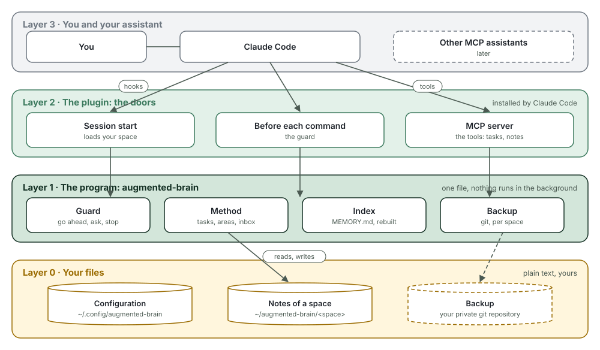
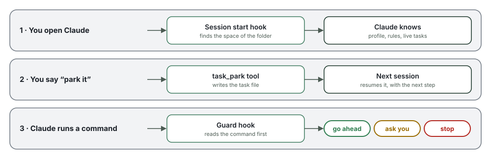

# How it works

[Leer en español](how-it-works.es.md)

augmented brain is one small program and a folder of notes. This is how the pieces fit:

<picture>
  <source media="(max-width: 600px)" srcset="../img/how-layers-narrow.en.svg">
  
</picture>

## Four layers

| Layer | What it is | Where it lives |
|---|---|---|
| **3 · You and your assistant** | You talk to Claude Code as usual. No new commands to learn. | Your terminal |
| **2 · The plugin** | The doors Claude uses to reach the program: two hooks and an MCP server. | Inside Claude Code, which installs it |
| **1 · The program** | `augmented-brain`, a single file. It guards commands, keeps tasks, rebuilds the index and runs the backup. | `~/.local/bin/augmented-brain` |
| **0 · Your files** | Plain text: the configuration, your notes and, if you want, their backup. | `~/.config/augmented-brain/`, `~/augmented-brain/` and your git repo |

Put another way: **your notes are a notebook, the program keeps it in order and the
plugin is the door.** You only talk to Claude; Claude comes in through the door and the
program writes in the notebook.

Two words that come up a lot:

- **Hook**: a call Claude Code makes at a given moment. Here, when a session starts and
  before every command. Each time, Claude Code starts the program, asks it, and the
  program exits. Nothing keeps running in the background.
- **MCP** (Model Context Protocol): an open standard to give tools to an assistant. The
  program offers its own ("open a task", "park it") and Claude uses them. Since it is a
  standard, other assistants will be able to use the same ones.

## A session, step by step

<picture>
  <source media="(max-width: 600px)" srcset="../img/how-session-narrow.en.svg">
  
</picture>

**1. You open Claude.** The start hook looks at the folder you are in and picks your
space. Before you type anything, it hands Claude your profile, your rules and the list of
live tasks. That is how it knows where you left off.

**2. You say "park it".** Claude uses the `task_park` tool. The program writes down in the
task file where it stopped and what the next step is, and rebuilds the index. The next
session starts from there. Opening, resuming and closing work the same way.

**3. Claude is about to run a command.** The guard hook reads it first and decides:

- **Go ahead**: almost always. `ls`, `go test`, `aws --profile dev s3 ls`.
- **Ask you**: production, or a machine you marked as untouchable.
  `aws --profile prod …`, `ssh db01 …`. Those two lists are for the whole machine: they
  apply in every space. An `aws` command is checked against every profile it may use:
  `--profile`, `AWS_PROFILE`, `AWS_DEFAULT_PROFILE`, or `default` when none is set. So
  are the tools that call AWS on their own (`cdk`, `sam`, `serverless`, `terraform`,
  `tofu`, `pulumi`, `eksctl`, `copilot`).
- **Stop**: pushing code, root and secrets. `git push`, `sudo …`, a token in a command,
  and what publishes like a push: `gh pr merge`, `gh release create`, `glab mr merge`.
  You can let Claude commit and push in a repository of yours, always written as
  `git -C <repo>`: list it in the space's `git_allowed_repos` to let it through, or in
  `git_ask_repos` to be asked each time. A worktree of a listed repository counts as
  it, and `~/code/app-*` covers every `app-<name>` folder next to `app`.

It also looks inside `ssh`, `bash -c`, loops, and what a pipe feeds a shell
(`echo 'sudo …' | bash`). If its configuration cannot be read, it asks you before every
`aws`, `ssh`, `scp`, `rsync`, `sftp` and `mosh`, and before the tools that call AWS
on their own, since it cannot tell which ones matter.
Commands Claude leaves running to watch something (a log, a build) are checked the same
way, and so are those of the helpers Claude starts (subagents and workflows). If the
guard cannot run at all, because the program is missing or broken, Claude Code stops
the command or the file change instead of letting it through (Claude Code 2.1.295 or
later).
`augmented-brain doctor` tries the guard for real and tells you if it is not working. It reads the shell, not PowerShell, so it
stops every PowerShell command too, and Claude runs it in Bash instead. It is a net
against slips, not a security wall: read the [disclaimer](../../DISCLAIMER.md).

**What is due that day.** If a task has a watch date for today or tomorrow, or you said
"remind me on Thursday" about something, Claude tells you as soon as you start. And when
the last review is a week old or more and there are captures in the inbox or stalled
tasks, it offers the weekly review: about ten minutes going through each of them with you.

**While you work, Claude writes as it goes.** Each decision or finished step goes to the
task's journal at the moment, not only when you park it: a session can end at any time.
If a task is open and nothing has been written to it for 20 minutes, a hook at the end of
Claude's answer reminds it, once. When a long conversation gets compacted (Claude Code
replaces the details with a summary), the summary is kept in `archive/sessions/`, the
task's journal points at it, and Claude writes down what was decided before going on.

**4. You close the session.** The end hook notes that the session ended well, and starts
the backup of the space, in the background, if you set one up. You wait for nothing. If
the backup fails, Claude tells you at the start of the next one. If a session did not end
well (the window was closed by force, the machine went down), the next one offers to
recover it: Claude reads what you both said after the task's last journal entry, from
Claude Code's own record of the conversation on this machine (it keeps it 30 days), and
writes down what is missing.

## Your files

Everything lives in `~/augmented-brain`, one folder per **space**. You work inside it,
and its notes go in `notes/`:

```
~/augmented-brain/
├── work/                 open Claude here for work
│   ├── notes/
│   │   ├── MEMORY.md     the index Claude reads at the start (written by the program)
│   │   ├── inbox.md      quick notes, to sort out later
│   │   ├── areas/        what you always look after: "the website", "the servers"
│   │   ├── tasks/        one file per task
│   │   ├── knowledge/    how things work and what you learned
│   │   ├── people/       who you deal with, so it knows who "Marcos" is
│   │   ├── rules/        rules for this space only
│   │   ├── reviews/      weekly reviews
│   │   └── archive/      old stuff; never loaded, never deleted
│   └── (your projects)
└── personal/             and here for personal things, with its own notes/
```

Your **profile**, who you are and how you like to work, is one for every space:
`~/.config/augmented-brain/profile.md`. You don't write it by hand: the first time you
open Claude, it asks six quick questions, saying why it asks each one. With your answers
it saves the profile, creates your areas, tells the guard what is production and which
machines must not be touched (for every space), and notes the people you work with. To change anything,
tell it.

A task is a text file. At the top, between the `---` lines, the data the program uses.
Below, what you and Claude write:

```markdown
---
id: task-add-a-contact-form
type: task
title: Add a contact form
area: area-website
status: parked
waiting_on: me
next: Write the plan
created: "2026-10-15"
updated: "2026-10-15"
---
## Essentials
Name, email and message, sent by email.

## Journal
- 2026-10-15 — Task opened.
- 2026-10-15 — Parked. Next: Write the plan
```

A big task can be split in two ways. A **step** is a small part: a checkbox in the
task's Plan, `- [ ] Buy the domain`, ticked when it is done; the index shows how many
are done ("2/5 steps"). A **subtask** is a part with a life of its own, because it waits
on someone else or goes at its own pace: a task of its own, with one more line at the
top, `parent:`, the id of the bigger task. The index lists it under that task. Only one
level: a subtask has no subtasks, and the bigger task closes last.

You can open and edit everything with any editor. The full format is in
[memory-format.md](../spec/memory-format.md).

## Work and personal, apart

A space is a full set of notes, rules and backup. The installer creates two, `work` and
`personal`. **The folder where you open Claude picks the space**, following your
configuration:

```toml
# ~/.config/augmented-brain/config.toml
default_space = "personal"

[spaces.work]
memory = "~/augmented-brain/work/notes"
work_folders = ["~/augmented-brain/work"]

[spaces.personal]
memory = "~/augmented-brain/personal/notes"
work_folders = ["~/augmented-brain/personal"]
```

In `~/augmented-brain/work/website`, Claude sees your work notes. In
`~/augmented-brain/personal/blog`, your personal ones. They never mix.

What if you open Claude in another folder? For example, the desktop app starts each new
session in a scratch folder of its own. Then the **default space**, `personal`, is used,
and Claude tells you in one line, with how to switch to work. Its backup is also the one
that keeps your profile. You can change it in `default_space`; if you have a single space,
it is that one. A space added with `space add` sets it when there was none.

Do your projects already live elsewhere, like `~/code`? Add that folder to the
`work_folders` of the right space. For a new space (a client, say):
`augmented-brain space add client`.

### Shared notes

Some things you learn hold everywhere: how git behaves, how you like answers, a lesson
about a tool. Saving them twice, once per space, would leave two copies that drift
apart. So they go once in the **shared notes**, next to your profile:
`~/.config/augmented-brain/shared/`. Only rules, references and lessons go there. Tasks,
areas and people always belong to one space.

Every space sees them. The shared rules are loaded at the start of each session, like
the space's own. The shared references and lessons are listed one line each, and Claude
opens the one it needs. You don't move files by hand: tell Claude "this holds
everywhere" and it saves the note as shared. They travel in the backup of the default
space, like your profile.

## The backup

The notes folder of each space is also a git repository. The backup pushes it to a
private repository of yours, one per space.

**Setting it up: ask Claude.** Say "set up the backup" (it offers at the end of the
interview). It creates a private repository in your GitHub account,
`augmented-brain-<space>`, connects it and makes the first copy. For that it uses `gh`,
GitHub's official command line: if you don't have it, Claude tells you how to install it
and walks you through the one step that needs your browser, logging in. Rather somewhere
else (GitLab, your company's git)? Give it the repository's address, or do it yourself:

```bash
augmented-brain backup setup git@gitlab.com:you/my-brain.git
```

From then on **it runs by itself every time a Claude session ends**, in the background.
If it fails (no network, no access to the repository), Claude tells you at the start of
the next one. You can also run it by hand:

```bash
augmented-brain backup          # this space
augmented-brain backup --all    # every space
```

### On a new machine

1. Install augmented brain with the usual command. It creates the spaces, empty. If
   Claude opens at the end, close it without doing the interview: your profile comes in
   the backup.
2. Bring each space back from its backup:
   ```bash
   augmented-brain restore https://github.com/you/augmented-brain-work.git
   ```
   It replaces the empty space with yours: notes, tasks, rules and the space's settings.
   Your profile comes with the default space (`personal`). The guard's lists
   (production, untouchable machines) are in no backup, since they may name your work's
   machines: the next session offers to ask you for them again. If that
   space already had notes of yours, it leaves it alone. If anything fails half way, the
   empty space stays as it was.
3. Open Claude. It carries on where you left off, and the backup keeps running by itself.

If the repository is on GitHub, log in once with `gh auth login` before restoring, so git
has access.

What you get:

- **A new machine in minutes**, with the three steps above.
- **Several machines, one brain.** Before pushing, the backup fetches what your other
  machine did and merges it.
- **Full history.** Every backup is a git commit, with the machine and the time. With
  `git log` you see what changed, and you can go back to any day.
- **Your place.** GitHub, GitLab or your own server: you pick the repository. augmented
  brain has no cloud.
- **One repository per space.** Work can go to your company's git, and personal to yours.
  Your profile only travels in the default space's backup, never in the work one.
- **No secrets go up.** If a note holds something that looks like a password or a token,
  the backup stops and tells you which file.
- **Nothing gets overwritten.** If two machines changed the same note, it stops without
  touching anything and explains how to sort it out. The index, being generated, is
  rebuilt by itself, and captures in the inbox from two machines are both kept. One
  catch: a capture you processed on one machine can come back if the other machine
  captured something at the same time. It just shows up again at the next review.
- **No junk, no giants.** Leftovers of a crash and the files systems drop in folders
  (`.DS_Store`, `Thumbs.db`) stay out. A file over 50 MB stays out too (GitHub refuses
  them), and Claude tells you which one at the start of the next session.

To turn the automatic backup off: `AB_NO_AUTO_BACKUP=1`.

## Bring in a memory you already have

If Claude Code has been keeping a memory for you (the files it writes in
`~/.claude/projects/<folder>/memory/`), you can bring it into your spaces:

```bash
augmented-brain import ~/.claude/projects/<folder>/memory
```

That writes nothing. It shows where each note would go and what it could not decide:
files that are not notes (an index), notes about you (copy what matters into your
profile), links that would cross from one space to another, ids your space already
has. When the list looks right, run it again with `--apply`. The folder you import
from is only read.

Each file becomes a note of its kind: by its name (`task-…`, `area-…`, `ref-…`,
`lesson-…`, `rule-…`, `person-…`) or else by what Claude Code says it is. A task with
no status comes in parked, waiting on you, with "review this imported task" as its next
step. With more than one space, a small file says which space each area goes to,
which notes go somewhere other than their area, and which go to the shared notes:

```text
area-family = personal
task-school-course = work
lesson-git-small-commits = shared
* = work
```

and goes in with `--map <file>`. `--repos-base <folder>` says what the notes' `repos:`
paths are relative to, so they are rewritten relative to the space's work folder.

## The panel

The panel is a page in your browser to see and change your spaces without going through
Claude. Open it with `/brain:panel` in Claude, or from a terminal:

```bash
augmented-brain panel
```

It opens your browser. If it cannot (on a computer with no screen, say), it prints an
address to open yourself. What you find there, space by space:

- **Tasks**: those waiting on you first, with their status and next step. Open one to
  read it whole, write in its journal, change its status or next step, park it or close
  it. You can open new ones too.
- **Reminders**: the watch dates of your tasks and the inbox reminders, overdue first.
  Add one, or mark it done.
- **Inbox**: capture an idea, or mark one as dealt with.
- **Areas**, **knowledge**, **rules** and **people**: to read, and to create areas.
  Knowledge and rules show the space's own and the shared ones, marked "shared".
- **Sessions**: your Claude sessions on this computer, from the last 30 days. Those that
  did not end (closed by force, or cut off when the computer went down) show what was
  said after the last journal entry: keep it in the notes (it goes to `archive/sessions/`
  with a line in the task's journal) or mark it as reviewed. Those running now, and those
  that ended, with how much disk their transcripts take (the files where Claude Code
  keeps each conversation). You can delete the transcript of an ended session; that
  session can then no longer be resumed.
- **Profile**: who you are and how you like to work, the same one every space uses.
- **Health**: notes that are not valid, repositories that notes point at and that are no
  longer on this computer, the index, the last backup and the last weekly review.

It changes your notes the same way Claude does, with the same program, and they wait for
each other: you can have both open at once.

It is made to stay yours:

- It runs **only while you use it**. After 30 minutes without use it stops by itself.
  To stop it now: `augmented-brain panel stop`, or the link at the bottom of the page.
- It works **only on this computer**. Other machines on your network cannot reach it.
- The address carries a **key**, made new each time the panel starts. Without it the
  panel answers nothing, so another program or web page on your computer cannot use it.
  The key stays in the address while you use the panel, so treat the address like a
  password: do not share it. It stops working when the panel stops.
- When you save a task, only what you changed on the page is saved: if Claude changed
  something else in the meantime, that stays. A step is ticked only if it still says
  what the page showed.
- It loads **nothing from the internet**: no fonts, no statistics. It works offline.

## What it does not do

- **No server and no account.** If Claude is not open, nothing runs, except the panel
  while you use it.
- **It sends your data to no one.** Only the backup, if you set it up, talks to your
  repository. Apart from that, once a day, it asks GitHub which version is the latest,
  sending nothing of yours. `AB_NO_UPDATE_CHECK=1` turns it off.
- **It does not touch your Claude Code settings.** The plugin goes in and out with Claude
  Code's own commands, which the installer, `update` and `uninstall` run for you.
- **Mind this: your assistant reads your notes**, like any file it opens. They travel with
  your conversations to its provider. Do not keep there what you would not share.

## Update it

When a new version is out, Claude tells you at the start of a session and offers to
update it. You can also do it yourself:

```bash
augmented-brain update
```

It updates the program and the Claude plugin. Then close and open Claude so it uses the
new version. Your notes and your configuration stay as they are, unless the new version
writes them in a different way: then the first session moves them to the new way, after
keeping a full copy in the `migrations/` folder of the configuration, and Claude tells
you. An older version refuses notes a newer one wrote, instead of breaking them: update
it on that computer too.

## Remove it

```bash
augmented-brain uninstall
```

It removes the Claude plugin, what Claude Code keeps of it and the program, after asking.
Your notes stay in `~/augmented-brain/`: they are yours. Your configuration stays too (to
remove it: `augmented-brain uninstall --config`), and so do Claude Code, its app and git.
If you install it again, you find everything as it was.

**To start from scratch**, `augmented-brain uninstall --all`: it also removes your
configuration, your profile and every space's notes. First it shows what it will remove,
with how many notes each folder has, and asks. Anything of yours inside a space's folder
stays. Your backup on GitHub is not deleted: it says which one it is and how to delete it.
