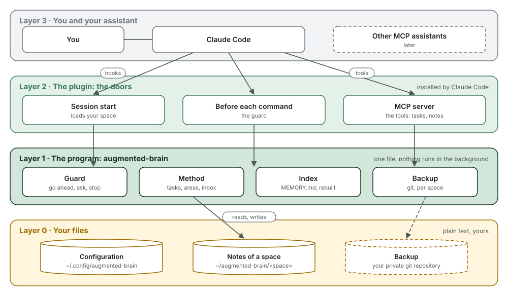
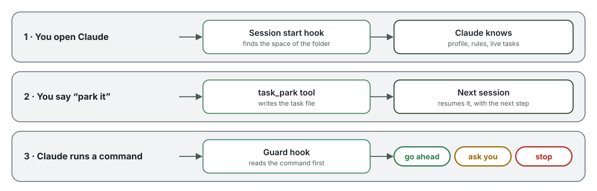

# How it works

[Leer en español](how-it-works.es.md)

augmented brain is one small program and a folder of notes. This is how the pieces fit:

<picture>
  <source media="(max-width: 600px)" srcset="../img/how-layers-narrow.en.svg">
  
</picture>

## Four layers

| Layer | What it is | Where it lives |
|---|---|---|
| **3 · You and your assistant** | You talk to Claude Code as usual. No new commands to learn. | Your terminal |
| **2 · The plugin** | The doors Claude uses to reach the program: two hooks and an MCP server. | Inside Claude Code, which installs it |
| **1 · The program** | `augmented-brain`, a single file. It guards commands, keeps tasks, rebuilds the index and runs the backup. | `~/.local/bin/augmented-brain` |
| **0 · Your files** | Plain text: the configuration, your notes and, if you want, their backup. | `~/.config/augmented-brain/`, `~/augmented-brain/` and your git repo |

Put another way: **your notes are a notebook, the program keeps it in order and the
plugin is the door.** You only talk to Claude; Claude comes in through the door and the
program writes in the notebook.

Two words that come up a lot:

- **Hook**: a call Claude Code makes at a given moment. Here, when a session starts and
  before every command. Each time, Claude Code starts the program, asks it, and the
  program exits. Nothing keeps running in the background.
- **MCP** (Model Context Protocol): an open standard to give tools to an assistant. The
  program offers its own ("open a task", "park it") and Claude uses them. Since it is a
  standard, other assistants will be able to use the same ones.

## A session, step by step

<picture>
  <source media="(max-width: 600px)" srcset="../img/how-session-narrow.en.svg">
  
</picture>

**1. You open Claude.** The start hook looks at the folder you are in and picks your
space. Before you type anything, it hands Claude your profile, your rules and the list of
live tasks. That is how it knows where you left off.

**2. You say "park it".** Claude uses the `task_park` tool. The program writes down in the
task file where it stopped and what the next step is, and rebuilds the index. The next
session starts from there. Opening, resuming and closing work the same way.

**3. Claude is about to run a command.** The guard hook reads it first and decides:

- **Go ahead**: almost always. `ls`, `go test`, `aws --profile dev s3 ls`.
- **Ask you**: production, or a machine you marked as untouchable.
  `aws --profile prod …`, `ssh db01 …`.
- **Stop**: pushing code, root and secrets. `git push`, `sudo …`, a token in a command.

It also looks inside `ssh`, `bash -c` and loops. It reads the shell, not PowerShell, so it
stops every PowerShell command too, and Claude runs it in Bash instead. It is a net
against slips, not a security wall: read the [disclaimer](../../DISCLAIMER.md).

**What is due that day.** If a task has a watch date for today or tomorrow, or you said
"remind me on Thursday" about something, Claude tells you as soon as you start. And when
the last review is a week old or more and there are captures in the inbox or stalled
tasks, it offers the weekly review: about ten minutes going through each of them with you.

**4. You close the session.** The end hook starts the backup of the space, in the
background, if you set one up. You wait for nothing. If it fails, Claude tells you at the
start of the next one.

## Your files

Everything lives in `~/augmented-brain`, one folder per **space**. You work inside it,
and its notes go in `notes/`:

```
~/augmented-brain/
├── work/                 open Claude here for work
│   ├── notes/
│   │   ├── MEMORY.md     the index Claude reads at the start (written by the program)
│   │   ├── inbox.md      quick notes, to sort out later
│   │   ├── areas/        what you always look after: "the website", "the servers"
│   │   ├── tasks/        one file per task
│   │   ├── knowledge/    how things work and what you learned
│   │   ├── people/       who you deal with, so it knows who "Marcos" is
│   │   ├── rules/        rules for this space only
│   │   ├── reviews/      weekly reviews
│   │   └── archive/      old stuff; never loaded, never deleted
│   └── (your projects)
└── personal/             and here for personal things, with its own notes/
```

Your **profile**, who you are and how you like to work, is one for every space:
`~/.config/augmented-brain/profile.md`. You don't write it by hand: the first time you
open Claude, it asks six quick questions, saying why it asks each one. With your answers
it saves the profile, creates your areas, tells the guard what is production and which
machines must not be touched, and notes the people you work with. To change anything,
tell it.

A task is a text file. At the top, between the `---` lines, the data the program uses.
Below, what you and Claude write:

```markdown
---
id: task-add-a-contact-form
type: task
title: Add a contact form
area: area-website
status: parked
waiting_on: me
next: Write the plan
created: "2026-10-15"
updated: "2026-10-15"
---
## Essentials
Name, email and message, sent by email.

## Journal
- 2026-10-15 — Task opened.
- 2026-10-15 — Parked. Next: Write the plan
```

You can open and edit everything with any editor. The full format is in
[memory-format.md](../spec/memory-format.md).

## Work and personal, apart

A space is a full set of notes, rules and backup. The installer creates two, `work` and
`personal`. **The folder where you open Claude picks the space**, following your
configuration:

```toml
# ~/.config/augmented-brain/config.toml
default_space = "personal"

[spaces.work]
memory = "~/augmented-brain/work/notes"
work_folders = ["~/augmented-brain/work"]

[spaces.personal]
memory = "~/augmented-brain/personal/notes"
work_folders = ["~/augmented-brain/personal"]
```

In `~/augmented-brain/work/website`, Claude sees your work notes. In
`~/augmented-brain/personal/blog`, your personal ones. They never mix.

What if you open Claude in another folder? For example, the desktop app starts each new
session in a scratch folder of its own. Then the **default space**, `personal`, is used,
and Claude tells you in one line, with how to switch to work. You can change it in
`default_space`, or remove it.

Do your projects already live elsewhere, like `~/code`? Add that folder to the
`work_folders` of the right space. For a new space (a client, say):
`augmented-brain space add client`.

## The backup

The notes folder of each space is also a git repository. The backup pushes it to a
private repository of yours, one per space.

**Setting it up: ask Claude.** Say "set up the backup" (it offers at the end of the
interview). It creates a private repository in your GitHub account,
`augmented-brain-<space>`, connects it and makes the first copy. For that it uses `gh`,
GitHub's official command line: if you don't have it, Claude tells you how to install it
and walks you through the one step that needs your browser, logging in. Rather somewhere
else (GitLab, your company's git)? Give it the repository's address, or do it yourself:

```bash
augmented-brain backup setup git@gitlab.com:you/my-brain.git
```

From then on **it runs by itself every time a Claude session ends**, in the background.
If it fails (no network, no access to the repository), Claude tells you at the start of
the next one. You can also run it by hand:

```bash
augmented-brain backup          # this space
augmented-brain backup --all    # every space
```

### On a new machine

1. Install augmented brain with the usual command. It creates the spaces, empty. If
   Claude opens at the end, close it without doing the interview: your profile comes in
   the backup.
2. Bring each space back from its backup:
   ```bash
   augmented-brain restore https://github.com/you/augmented-brain-work.git
   ```
   It replaces the empty space with yours: notes, tasks, rules, your profile and the
   space's settings. If that space already had notes of yours, it leaves it alone.
3. Open Claude. It carries on where you left off, and the backup keeps running by itself.

If the repository is on GitHub, log in once with `gh auth login` before restoring, so git
has access.

What you get:

- **A new machine in minutes**, with the three steps above.
- **Several machines, one brain.** Before pushing, the backup fetches what your other
  machine did and merges it.
- **Full history.** Every backup is a git commit, with the machine and the time. With
  `git log` you see what changed, and you can go back to any day.
- **Your place.** GitHub, GitLab or your own server: you pick the repository. augmented
  brain has no cloud.
- **One repository per space.** Work can go to your company's git, and personal to yours.
- **No secrets go up.** If a note holds something that looks like a password or a token,
  the backup stops and tells you which file.
- **Nothing gets overwritten.** If two machines changed the same note, it stops without
  touching anything and explains how to sort it out. The index, being generated, is
  rebuilt by itself.

To turn the automatic backup off: `AB_NO_AUTO_BACKUP=1`.

## What it does not do

- **No server and no account.** If Claude is not open, nothing runs.
- **It sends your data to no one.** Only the backup, if you set it up, talks to your
  repository. Apart from that, once a day, it asks GitHub which version is the latest,
  sending nothing of yours. `AB_NO_UPDATE_CHECK=1` turns it off.
- **It does not touch your Claude Code settings.** The plugin goes in and out with Claude
  Code's own commands, which the installer, `update` and `uninstall` run for you.
- **Mind this: your assistant reads your notes**, like any file it opens. They travel with
  your conversations to its provider. Do not keep there what you would not share.

## Update it

When a new version is out, Claude tells you at the start of a session and offers to
update it. You can also do it yourself:

```bash
augmented-brain update
```

It updates the program and the Claude plugin. Your notes and your configuration are not
touched. Then close and open Claude so it uses the new version.

## Remove it

```bash
augmented-brain uninstall
```

It removes the Claude plugin and the program, after asking. Your notes stay in
`~/augmented-brain/`: they are yours. Your configuration stays too (to remove it:
`augmented-brain uninstall --config`), and so do Claude Code, its app and git. If you
install it again, you find everything as it was.
